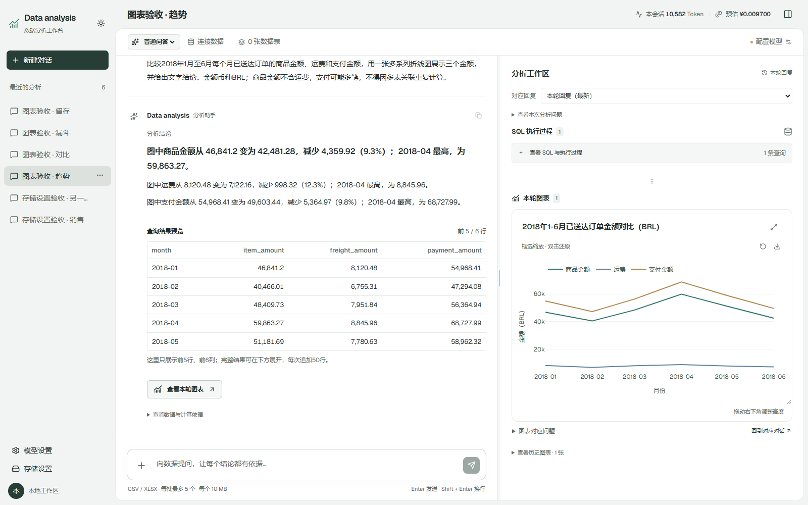

# DATA analysis

一个由分析师主导的分析 Agent：把业务问题转成有口径、有证据、可继续追问的分析结果。

**Next.js · FastAPI · LangGraph · DuckDB · Plotly**



*实际产品历史截图，使用公开 Olist 教学样本；图中单位为 BRL。展示界面与图表能力，不代表所有业务任务已通过验收。*

## 核心思路

**理解问题 → 明确分析要求 → 检查相关数据 → 确认业务规则 → 执行计算 → 核对证据 → 分项交付**

- **分析师做判断，Agent 做准备与执行。** 对会改变结果的业务规则，先提出建议、理由和影响，由人确认；已确认的内容可复用。
- **指标定义与本轮条件分开。** 固定公式、主体、关联及缺失策略；追问只调整期间、筛选和分组，程序组合计算，避免每轮重写口径。
- **先看数据是否支持当前问题。** 核对字段、粒度、唯一键和范围；各事实独立汇总，避免多表关联把金额算大。无记录、未知金额和真实零分别处理。
- **清洗有版本，也有影响对照。** 保留原始数据，清洗先预览；用同一计算依据比较前后结果，支持应用与撤销。
- **成功执行不等于结论正确。** 结果保留 SQL、数据版本与来源；计算、业务口径和解释分别说明证据。有缺口就限定范围或暂停受影响部分，不把局部成功说成全部完成。

## 本地运行

推荐 Python 3.11、Node.js 20.9+，以下使用 PowerShell 7。

```powershell
git clone https://github.com/xincheng-learning/DATA-analysis.git
cd DATA-analysis
python -m venv .venv
./.venv/Scripts/python.exe -m pip install -r backend/requirements.txt
Copy-Item .env.example .env
./.venv/Scripts/python.exe -X utf8 -m uvicorn app.main:app --app-dir backend --host 127.0.0.1 --port 8000
```

另开终端，在项目目录运行：

```powershell
cd frontend
Copy-Item .env.example .env.local
npm ci
npm run dev -- --hostname 127.0.0.1 --port 3000
```

打开 <http://127.0.0.1:3000>，在“模型设置”填写自己的模型接口、模型名称及密钥。本地模式使用 SQLite，无需 Supabase。SQL 与图表不依赖 Docker；Python 代码执行需要另外准备隔离运行环境。已有配置请保留，不要重复覆盖。

## 代码与验证

- `backend/app/agent/`：意图、路由和工具执行；`business_contract*.py`：固定指标与确认绑定。
- `backend/app/cleaning_impact.py`：清洗影响对照；`analysis_pipeline.py`：证据与交付。
- `frontend/`：对话、图表工作区与交付状态；`evals/`：合成测试及公开参考材料。

可导入 [工作流合成数据](evals/analyst_workflow_gold_v1/data/commerce/) 的订单、明细、退款和目标表，体验口径确认与条件追问。测试材料不含真实客户上传数据。

发布前相关离线检查通过；完整业务黄金集仍有未完成项，不宣称所有场景正确。首购归属、复杂跨期计算、大表和多人并发仍有限制。模型调用可能收费；密钥只放本机，不要提交 `.env` 或写进 `NEXT_PUBLIC_` 配置。

## 来源与许可

基于 [Devam Shah / DataPilot](https://github.com/devamshah22/datapilot) 持续改造，保留 MIT 许可与原作者署名。本分支重点改进分析师工作流、固定计算契约、清洗影响和可信交付；贡献范围见 [NOTICE](NOTICE.md)，许可证见 [LICENSE](LICENSE)。
